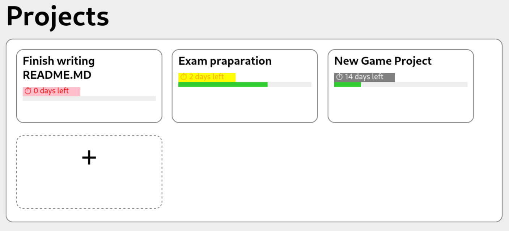
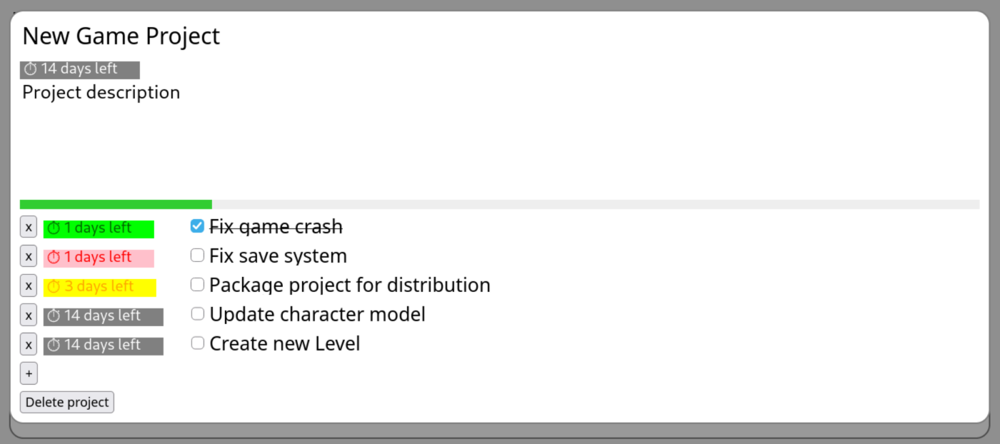

#React Productivity App

A university project productivity to-do list application built with React class components, featuring multiple projects with subtasks and due date tracking. All data is automatically saved to browser's LocalStorage without requiring a backend server.

## Features

- **Multiple Projects**: Create and manage unlimited projects, each representing a different task or goal
- **Subtasks**: Each project can contain multiple subtasks with individual completion status
- **Progress Tracking**: Real-time percentage completion calculation for each project
- **Due Date Tracking**: Set due dates for both projects and individual subtasks
- **Time Remaining Display**: Color-coded visual countdown showing days left until deadlines
- **Interactive UI**: Editable fields for task project names, descriptions, dates and individual tasks
- **Persistent Storage**: All data automatically saved to browser's LocalStorage




## Technologies Used

- **React 17.0.2** - Frontend JavaScript library
- **Create React App** - Build tooling and development environment
- **LocalStorage** - Client-side data persistence

## Getting Started

### Prerequisites

- Node.js (v14 or higher)
- npm or yarn package manager

### Installation

1.  Navigate to the project directory:
    ```bash
    cd react-productivity-app
    ```
2.  Install dependencies:
    ```bash
    npm install
    ```
3.  Start the development server:
    ```bash
    npm start
    ```
4.  Open your browser and navigate to http://localhost:3000

### How to Use
Add a New Project: Click the + button on the dashboard to create a new project
Edit Project Details: Modify the project name, team name, and description
Manage Tasks:
Add new subtasks using "+" button
Mark tasks as complete with checkboxes
Delete tasks with the "x" button
Set Due Dates: Use the date picker to set deadlines for each task
Track Progress: View completion percentage automatically calculated

### Data Persistence
All data is stored in your browser's LocalStorage:
Projects, tasks, and settings persist across page reloads
No server or database required
Data is automatically saved when you make changes
Clear browser cache to reset all data
